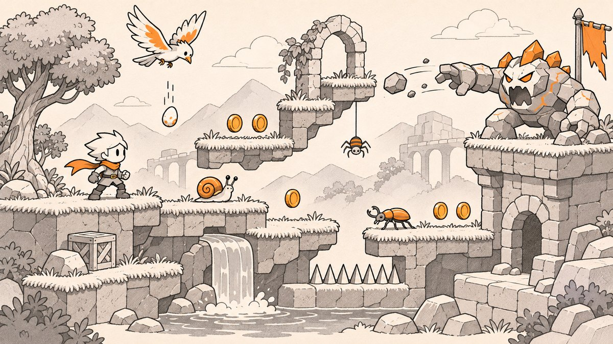

# Unity 2D Bird Adventure

Enemy, hazard, pickup and camera scripts for a small Unity 2D side-scrolling platformer.

## What it does

These scripts make up the world side of a 2D platformer: a bird that patrols and drops an egg on the player, snails and beetles that can be stomped or shot, a spider that bobs up and down, a boss that throws stones, coins to collect, a camera that follows the player, and a background that scales to fit the screen.

The player side (movement, shooting, lives and score) lives in [unity-2d-player-controller](https://github.com/MemeGamer/unity-2d-player-controller), and the menu buttons live in [unity-main-menu-ui](https://github.com/MemeGamer/unity-main-menu-ui). All three were uploaded together and belong to the same game.

## How it works

- **BirdScript** moves the bird 8 units left and right of its start point, flipping its sprite at each end. It raycasts straight down on a `playerLayer` mask and, the first time it finds the player, spawns the `birdEgg` prefab below itself. A `Bullet` hit plays `BirdDead`, makes the body dynamic so it falls, and disables it after 3 seconds. Touching the `Player` calls `PlayerDamage.DealDamage()`.
- **EggScript** damages the player on collision and disables itself on any collision.
- **Snail** walks left or right using `Rigidbody2D` velocity and turns around when a downward raycast from `downcol` finds no ground. Side raycasts from `leftcol` and `rightcol` damage the player. If the player lands on `topcol`, the player is bounced up and the enemy is stunned (`stunned1`). Objects tagged `snail` take two bullet hits (stun, then disable); objects tagged `Beetal` are removed by one stomp or one bullet.
- **SpiderScript** moves 1 unit up and down from its start point, dies to a `Bullet` like the bird, and damages the `Player` on contact.
- **BossScript** waits 2 to 5 seconds at random, plays `AttackAnimation`, and repeats. `Attack()` and `BackToIdel()` are meant to be called from animation events: `Attack()` spawns a `Stone` at `attackInstantiate` and pushes it left. `DeactivateBossScript()` stops the loop.
- **StoneScript** damages the player on contact and disables itself after 4 seconds.
- **SpawnnerScript** spawns `bombPrefab2` at a random x between -2.23 and 2.85 every 0 to 1.5 seconds.
- **CoinCollect** disables a coin when the `Player` touches it. **Bdisable** disables its object when it touches something tagged `G1`.
- **CameraScript** finds the `Player` by tag and smooth-damps the camera forward on x only (it never scrolls back). It sizes its own `BoxCollider2D` to the camera view.
- **BG** scales a background `SpriteRenderer` so it fills the orthographic camera view.
- **SoundSc** plays its `AudioSource` when Space is pressed (jump sound).

## Tech

- Unity (2D physics, Animator, legacy Input Manager), C#.
- The repository has no `ProjectSettings`, so the exact Unity version is not recorded. The code uses APIs available in Unity 2019 and 2020.

## Use it

1. Create a Unity 2D project and copy the `.cs` files into `Assets/`.
2. Add the player scripts from [unity-2d-player-controller](https://github.com/MemeGamer/unity-2d-player-controller). The enemies call `PlayerDamage.DealDamage()`, so the project will not compile without `PlayerDamage.cs`.
3. Create these tags: `Player`, `Bullet`, `snail`, `Beetal`, `G1`.
4. Set up each enemy with a `Rigidbody2D`, a `BoxCollider2D` (trigger where it should detect bullets), and an `Animator` whose states match the names the code plays: `BirdFly`, `BirdDead`, `stunned1`, `Stunned`, `SpiderDead`, `AttackAnimation`, `BossAnimation`.
5. For `Snail`, add four child transforms and assign them to `leftcol`, `rightcol`, `topcol` and `downcol`, and set `playerlayer`. For `BirdScript`, assign `birdEgg` and `playerLayer`.
6. For `BossScript`, assign the `Stone` prefab and an `attackInstantiate` transform, and add animation events that call `Attack` and `BackToIdel`.
7. Put `CameraScript` on the main camera together with a `BoxCollider2D`, and `BG` on the background sprite.

## Scripts

| Script | Purpose |
| --- | --- |
| `BirdScript.cs` | Patrolling bird that drops an egg when the player is below |
| `EggScript.cs` | Egg that damages the player on impact |
| `Snail.cs` | Ground enemy (snail or beetle) with edge detection, stomp and shoot reactions |
| `SpiderScript.cs` | Spider that moves up and down and can be shot |
| `BossScript.cs` | Boss attack loop that throws stones |
| `StoneScript.cs` | Thrown stone that damages the player |
| `SpawnnerScript.cs` | Spawns falling bomb prefabs at random x positions |
| `CoinCollect.cs` | Hides a coin when the player touches it |
| `Bdisable.cs` | Disables its object when it hits a `G1` tagged object |
| `CameraScript.cs` | Forward-only smooth camera follow |
| `BG.cs` | Scales a background sprite to fill the camera |
| `SoundSc.cs` | Plays a sound on Space |

## Notes

- This repository contains scripts only: no scenes, sprites, prefabs, animations or project settings. You need to rebuild the scene yourself to play it.
- Tag names are case sensitive and partly misspelled in code (`Beetal`). Keep them exactly as written or update the scripts.
- Input uses the legacy Input Manager (`Input.GetKeyDown`), which needs "Active Input Handling" set to the old system or Both in newer Unity versions.
